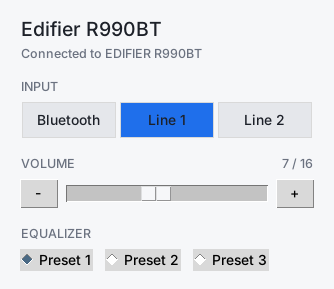

# edifier-r990bt-control

Control an **Edifier R990BT** speaker from a Windows PC over Bluetooth LE: switch inputs (Bluetooth, Line 1, Line 2), change the volume and pick an EQ preset without touching the rear knob or the phone app.

> Unofficial project, not affiliated with Edifier. It uses an undocumented protocol, reverse-engineered by the community from the EDIFIER ConneX app. Use at your own risk.



## Download

Grab `EdifierR990BT.exe` from the [latest release](../../releases/latest) and double-click it. No installation and no Python needed.

Windows SmartScreen may warn that the app is from an unknown publisher, because the executable is not code-signed. Click **More info > Run anyway**.

Requirements: Windows 10 or 11 with Bluetooth 4.0 or later. Most laptops have it; desktop PCs may need a USB adapter.

## Using the app

- **Connect audio (Win+K):** opens the Windows panel to connect this PC to the speaker as a Bluetooth audio device (same as pressing `Win + K`).
- **Input:** Bluetooth, Line 1, Line 2.
- **Volume:** slider and `-` / `+` buttons (0 to 16, the speaker's own scale).
- **EQ:** the speaker's three presets: Music, Movie and Game.
- **Settings...:** rename the speaker (up to 30 characters), turn the Bluetooth connection prompt tone on or off, and set how the app starts, minimizes and closes (see below).
- **Pair new device:** disconnects the current Bluetooth audio device and leaves the speaker in pairing mode (blue LED blinking), like holding its Bluetooth button. The app loses the speaker for a minute or two and then reconnects by itself. To reconnect a Windows PC afterwards, press `Win + K` and pick the speaker.
- **Turn off:** powers the speaker down. It can only be turned back on with its knob; the app reconnects by itself when it is.

### Prevent auto-mute

The R990BT switches its amplifier off when the audio stream stops or the signal drops below a very low level, and switches it back on when sound returns. In films this cuts quiet ambience and the start of sounds after a silence.

**Prevent auto-mute** makes the app play a 25 Hz tone at -60, -50 or -40 dBFS through the default Windows output. The speaker's rated frequency response starts at 60 Hz, so the tone is practically inaudible, but it keeps the stream alive and the amplifier on. Start with -50 dB and go up only if the speaker still mutes.

It only affects audio played by this PC, over Bluetooth or a PC-to-RCA cable. It cannot help a TV or other device plugged into the RCA inputs, because the PC has no way to inject a signal into that cable.

### Phone remote

Tick **Allow control from a phone on this Wi-Fi** and press **Show QR**. Scanning the code opens a page with the same controls on the phone. The PC must be on with the app running.

The link includes a random access key, so other devices on the network cannot use it without the QR. The server listens on port 8765. The first time, Windows asks whether to allow the app on the network: allow it on **private** networks.

### Start with Windows, tray and closing

In **Settings... > App**:

- **Start with Windows (minimized):** the app starts when you sign in, minimized to the taskbar, or hidden in the tray if *Minimize to the tray* is on. It is a per-user entry under `HKCU\Software\Microsoft\Windows\CurrentVersion\Run`, so it needs no admin rights, and it also shows up in **Task Manager > Startup apps**, where it can be turned off too. If you move the exe, open it once from the new folder and the entry follows it.
- **Show icon in the system tray:** an icon next to the clock whose menu switches inputs without opening the window.
- **Minimize to the tray instead of the taskbar** and **Keep running in the tray when the window is closed:** off by default, so minimizing goes to the taskbar and closing the window quits the app. With the second one on, use **Quit** in the tray menu to exit.

The phone remote and auto-mute prevention only work while the app is running. Only one copy runs at a time: opening it again while it is running brings up its window.

The first time, the app searches for the speaker and saves its address in `%APPDATA%\edifier-r990bt-control\config.json`. Delete that file to pair the app with a different speaker.

The interface is in English, or in Spanish when Windows is set to Spanish. Set the environment variable `EDIFIER_LANG=en` or `EDIFIER_LANG=es` to force a language.

### Tips

- **Close ConneX on your phone.** The speaker accepts only one control connection at a time.
- **Bluetooth hidden mode.** According to the manual, if no Bluetooth audio device connects for 30 minutes the speaker enters a hidden mode (blue LED breathing). If the app cannot find the speaker, press the knob once to leave that mode.
- **The speaker advertises intermittently.** If the app can't find it the first time, play something over Bluetooth for a few seconds. Once found, the app remembers it and reconnects on its own.

## Command-line tool

`edifier-cli.exe`, also in the release, does the same from a terminal, which makes it easy to call from scripts, AutoHotkey, Stream Deck and the like:

```bash
edifier-cli source line1
```

```bash
edifier-cli volume +2
```

```bash
edifier-cli eq movie
```

| Command | What it does |
|---|---|
| `source bt\|line1\|line2` | Switch input |
| `volume [N\|+N\|-N]` | Show or set the volume |
| `eq music\|movie\|game` | Select an EQ preset |
| `name [new name]` | Show or change the speaker name |
| `tone [on\|off]` | Show or set the Bluetooth prompt tone |
| `pair` | Disconnect the audio device and enter pairing mode |
| `off` | Turn the speaker off |
| `info` | Show capabilities, name, firmware, input, volume and EQ |
| `scan [--all]` | List nearby Edifier (or all) BLE devices |
| `gatt` | List the speaker's GATT services |
| `watch` | Print the active input while you turn the knob |
| `send <opcode> [payload]` | Send a raw command (advanced) |
| `forget` | Forget the saved speaker |

Every command appends its output to `diagnostics.txt` in the current folder. Remove Bluetooth addresses before sharing that file.

## How it works

The speaker has two independent Bluetooth radios:

- **Classic Bluetooth (A2DP)** carries the audio.
- **Bluetooth LE** carries control commands. This is what ConneX, and this app, use.

Commands are framed like this:

```text
AA EC <opcode> <length: 2 bytes> <payload> <checksum>    request
BB EC <opcode> <length: 2 bytes> <payload> <checksum>    reply
```

The checksum is the low byte of the sum of all preceding bytes.

### R990BT protocol reference

Verified on an R990BT with firmware 1.0.2. Each change was set, acknowledged and read back.

| | Value |
|---|---|
| BLE name | `EDIFIER BLE` |
| Advertised UUID | `0000d300-0000-1000-8000-00805f9b34fb` |
| GATT service | `4809d301-1a48-11e9-ab14-d663bd873d93` |
| Notify characteristic | `48090001-1a48-11e9-ab14-d663bd873d93` |
| Write characteristic | `48090002-1a48-11e9-ab14-d663bd873d93` |

| Function | Query | Set | Values |
|---|---|---|---|
| Input | `AA EC 61 00 00 F7` → `<group> <input>` | `AA EC 62 00 02 06 <input> <chk>` | group `06`; `01` Bluetooth, `02` Line 1, `03` Line 2 |
| Volume | `AA EC 66 00 00 FC` → `<max> <current>` | `AA EC 67 00 01 <vol> <chk>` | 0 to 16 |
| EQ preset | `AA EC D5 00 00 6B` → `<preset>` | `AA EC C4 00 01 <preset> <chk>` | `00` Music, `02` Movie, `01` Game |
| Name | `AA EC C9 00 00 5F` | `AA EC CA <len> <UTF-8 name> <chk>` | up to 30 bytes |
| Prompt tone | `AA EC F9 00 00 8F` → `<state>` | `AA EC FA 00 01 <state> <chk>` | `00` off, `01` on |
| Firmware | `AA EC C6 00 00 5C` | | 3 bytes |
| Capabilities | `AA EC D8 00 00 6E` | | 22 bytes |
| Power off | | `AA EC CE 00 00 64` | no reply; the speaker turns off |
| Disconnect audio | | `AA EC CD 00 00 63` | no reply; pairing mode, BLE drops for 1-2 min |

After an input change the speaker also sends `0xC3` notifications with the state of the Bluetooth audio link.

### Power and standby

`0xCE` puts the speaker in standby, the same as holding the knob (the manual calls it standby mode). Once off, it stops advertising over BLE and cannot be reached, and reconnecting Bluetooth audio from Windows does not wake it. It has to be turned back on with the rear knob, so the speaker can be switched off from the PC but not on.

Capabilities payload on the tested unit:

```text
00 00 01 02 01 01 01 00 00 00 01 01 0A 0F 01 00 00 22 00 03 00 00
```

## Running from source

Requires Python 3.10 or later.

```bash
py -m pip install -r requirements.txt
```

Start the app (or double-click `Edifier R990BT.pyw`):

```bash
py -m edifier_ctl.gui
```

Use the command-line tool:

```bash
py -m edifier_ctl info
```

### Building the executables

GitHub Actions builds both executables on every push and attaches them to a release when a `v*` tag is pushed. To build locally on Windows:

```bash
powershell -ExecutionPolicy Bypass -File packaging\build.ps1
```

The output lands in `dist\`.

## What else the speaker supports

An analysis of the ConneX app shows exactly which features the R990BT exposes and confirms there is no setting for its auto-mute. See [docs/CONNEX_ANALYSIS.md](docs/CONNEX_ANALYSIS.md).

## Other Edifier speakers

The control service of ConneX speakers follows the pattern `4809xxxx-1a48-11e9-ab14-d663bd873d93`, so the scan, info and watch commands may work on other models. Input and EQ codes differ per model: run `watch` and turn the knob to find them. If the speaker doesn't answer at all, [docs/ANDROID_CAPTURE.md](docs/ANDROID_CAPTURE.md) explains how to capture what ConneX sends.

## Credits

Community projects that documented the protocol on other models:

- [kralonur/edifier-speakers-ble](https://github.com/kralonur/edifier-speakers-ble): M60 and M90, including input switching.
- [hifn123p/edifier-center](https://github.com/hifn123p/edifier-center): MR5BT, Windows tray app.
- [Devis99/omarchy-edifier-mr5](https://github.com/Devis99/omarchy-edifier-mr5): MR5.

## License

MIT
