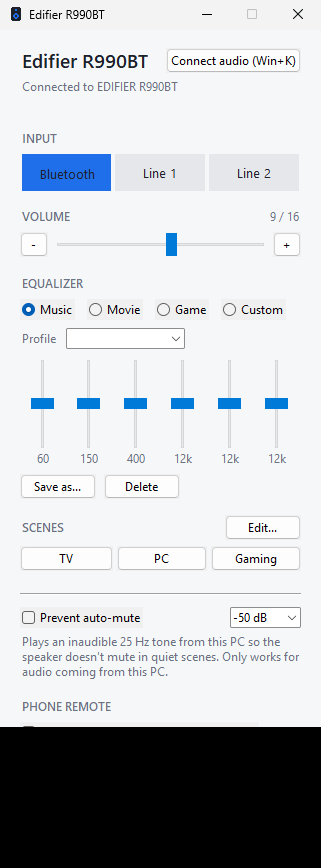
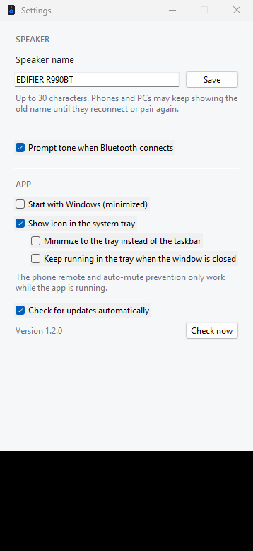

# edifier-r990bt-control

Control an **Edifier R990BT** speaker from a Windows PC over Bluetooth LE: input, volume, EQ and more, without touching the rear knob or the phone app.

> Unofficial project, not affiliated with Edifier. It uses an undocumented protocol, reverse-engineered from the EDIFIER ConneX app. Use at your own risk.

<p>
  
  
</p>

## Download

From the [latest release](../../releases/latest):

- **`EdifierR990BT-Setup.exe`** (recommended): installs for your user only, no admin rights, with a Start menu shortcut and an uninstaller.
- **`EdifierR990BT.exe`**: portable, a single file you can run from any folder.

Both update themselves. No Python needed.

**On a phone, without a PC:** open the [phone remote](https://frangiac0.github.io/edifier-r990bt-control/) in Chrome on Android (or Bluefy on iPhone) and add it to the home screen.

Requires Windows 10 or 11 with Bluetooth 4.0 or later. The exe is not code-signed, so SmartScreen may ask for **More info > Run anyway**.

## Features

- **Input:** Bluetooth, Line 1, Line 2.
- **Volume** (0 to 16, the speaker's own scale) and **EQ presets:** Music, Movie, Game.
- **Scenes:** save input + EQ combinations (for example *TV* = Line 1 + Movie) and apply them with one click, also from the tray.
- **Sleep timer:** turns the speaker off after 15 minutes to 3 hours.
- **Connect audio (Win+K):** opens the Windows panel to connect the PC to the speaker over Bluetooth.
- **Pair new device:** drops the current audio device and puts the speaker in pairing mode. The app reconnects by itself in a minute or two.
- **Turn off:** standby. It can only be turned back on with the knob.
- **Prevent auto-mute** for audio played from the PC.
- **Phone remote**, either directly over Bluetooth (no PC) or through the PC app over Wi-Fi.
- **Settings:** speaker name, connection prompt tone, start with Windows, tray icon, minimize and close behaviour, automatic updates.
- **Command-line tool** for scripts and hotkeys.

Interface in English, or Spanish when Windows is in Spanish.

The speaker itself has limits that no app can lift: its auto-mute is fixed in firmware, there is no custom EQ (only the three presets) and it cannot be turned on remotely. See [what the speaker exposes](docs/CONNEX_ANALYSIS.md).

## Details

<details>
<summary><b>If the app can't find the speaker</b></summary>

- **Close ConneX on your phone.** The speaker accepts only one control connection at a time.
- **Hidden mode.** After 30 minutes without a Bluetooth audio device the speaker hides (blue LED breathing). Press the knob once.
- **Intermittent advertising.** Play something over Bluetooth for a few seconds. Once found, the app remembers the speaker and reconnects on its own.

The address is saved in `%APPDATA%\edifier-r990bt-control\config.json`. Delete that file to use the app with a different speaker.
</details>

<details>
<summary><b>Prevent auto-mute</b></summary>

The R990BT switches its amplifier off when the signal stops or drops very low, and back on when sound returns, which cuts quiet ambience and the start of sounds in films. The app can play a 25 Hz tone at -60, -50 or -40 dBFS through the default Windows output: below the speaker's 60 Hz range, so practically inaudible, but enough to keep the amplifier on. Start with -50 dB.

It only works for audio played by this PC (Bluetooth or a PC-to-RCA cable), not for a TV or other device on the RCA inputs.
</details>

<details>
<summary><b>Phone remote</b></summary>

**Directly over Bluetooth, no PC.** The [web app](https://frangiac0.github.io/edifier-r990bt-control/) connects to the speaker with Web Bluetooth: input, volume, EQ, scenes (saved on the phone), pairing and power off. It works in Chrome on Android and in the Bluefy browser on iPhone (Safari has no Web Bluetooth). Use *Add to home screen* to install it. The speaker accepts one control connection at a time, so quit the PC app and ConneX first. The first time, pick **EDIFIER BLE** in the list; depending on the browser, later connections may ask again.

**Through the PC app, over Wi-Fi.** Tick **Allow control from a phone on this Wi-Fi** and press **Show QR**. The page has the same controls and works while the app is running. The link carries a random key, so other devices on the network can't use it without the QR. Port 8765; when Windows asks, allow the app on **private** networks. In Brave, turn off forced HTTPS for the page.
</details>

<details>
<summary><b>Start with Windows, tray and updates</b></summary>

All in **Settings... > App**:

- **Start with Windows** adds a per-user entry (`HKCU\...\CurrentVersion\Run`, no admin rights), also listed in Task Manager > Startup apps. The app starts minimized.
- **Tray icon:** quick input switching from the menu next to the clock. Optionally, minimize and/or close to the tray. By default minimizing goes to the taskbar and closing quits.
- **Updates:** checked at startup and once a day against the latest GitHub release. A bar in the window offers to download, replace the exe and restart. The download is checked against the SHA-256 that GitHub records for the release file. It updates the app only, not `edifier-cli.exe`.

Only one copy runs at a time: opening it again brings up the running window.
</details>

<details>
<summary><b>Command-line tool</b></summary>

`edifier-cli.exe`, also in the release, for scripts, AutoHotkey, Stream Deck and the like:

```bash
edifier-cli source line1
```

| Command | What it does |
|---|---|
| `source bt\|line1\|line2` | Switch input |
| `volume [N\|+N\|-N]` | Show or set the volume |
| `eq music\|movie\|game` | Select an EQ preset |
| `name [new name]` | Show or change the speaker name |
| `tone [on\|off]` | Show or set the Bluetooth prompt tone |
| `pair` | Disconnect the audio device and enter pairing mode |
| `off` | Turn the speaker off |
| `info` | Show capabilities, name, firmware, input, volume and EQ |
| `scan [--all]` | List nearby Edifier (or all) BLE devices |
| `gatt` | List the speaker's GATT services |
| `watch` | Print the active input while you turn the knob |
| `probe [--only HH,HH]` | Safely query read-only opcodes to look for undocumented ones |
| `send <opcode> [payload]` | Send a raw command (advanced) |
| `forget` | Forget the saved speaker |

Every command appends its output to `diagnostics.txt` in the current folder. Remove Bluetooth addresses before sharing that file.
</details>

<details>
<summary><b>Running from source and building</b></summary>

Requires Python 3.10 or later.

```bash
py -m pip install -r requirements.txt
```

Start the app (or double-click `Edifier R990BT.pyw`):

```bash
py -m edifier_ctl.gui
```

Use the command-line tool:

```bash
py -m edifier_ctl info
```

**Building the executables.**

GitHub Actions builds both executables on every push and attaches them to a release when a `v*` tag is pushed. To build locally on Windows:

```bash
powershell -ExecutionPolicy Bypass -File packaging\build.ps1
```

The output lands in `dist\`.
</details>

## Technical documentation

- [docs/PROTOCOL.md](docs/PROTOCOL.md): BLE protocol, command table, other Edifier models.
- [docs/CONNEX_ANALYSIS.md](docs/CONNEX_ANALYSIS.md): what the ConneX app exposes for this speaker.
- [docs/ANDROID_CAPTURE.md](docs/ANDROID_CAPTURE.md): capturing ConneX traffic for other models.

## Credits

Community projects that documented the protocol on other models:

- [kralonur/edifier-speakers-ble](https://github.com/kralonur/edifier-speakers-ble): M60 and M90, including input switching.
- [hifn123p/edifier-center](https://github.com/hifn123p/edifier-center): MR5BT, Windows tray app.
- [Devis99/omarchy-edifier-mr5](https://github.com/Devis99/omarchy-edifier-mr5): MR5.

## License

MIT
